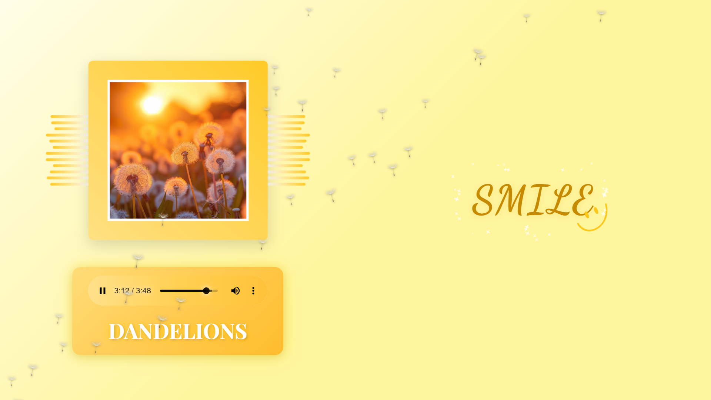

# DANDELIONS

An audio-reactive music visualizer inspired by **“Dandelions” performed by Ruth B.** It brings the song to life through responsive visuals, synchronized lyrics, animated typography, sparkles, and floating dandelion seeds.

DANDELIONS is a browser-based project built with HTML, CSS, and JavaScript.



## Features

- **Audio-reactive visualizer** — the central image and surrounding bars respond to the audio.
- **Synchronized lyrics** — lyrics follow the song using enhanced word-level timestamps.
- **Animated typography** — words and selected lyric moments have individual visual effects.
- **Golden sparkles** — special lyric highlights trigger sparkle animations.
- **Floating dandelion seeds** — seeds drift across the screen during playback, with additional effects triggered by the lyrics.
- **Playback-aware animations** — visual and lyric animations respond to playback, pauses, seeking, and tab visibility.

## Run locally

### Requirements

- [Node.js](https://nodejs.org/) installed.
- A modern web browser.
- An internet connection for the Liricle library and Google Fonts loaded from their CDNs.

### Option 1: Use the included Node.js server

1. Clone the repository:

   ```bash
   git clone https://github.com/eswarsai268/Dandelions_Visualizer.git
   ```

2. Open the project folder:

   ```bash
   cd Dandelions_Visualizer
   ```

3. Start the local server:

   ```bash
   node server.js
   ```

4. Open **http://localhost:3000** in your browser.

No `npm install` step is required; the included server uses Node.js built-in modules.

### Option 2: Use VS Code Live Server

Open the project folder in VS Code, then launch `dandelions.html` using the Live Server extension.

## Project structure

```text
Dandelions_Visualizer/
├── assets/
│   ├── dandelion_seed.png
│   ├── dandelions.jpeg
│   ├── dandelions.mpeg
│   ├── dandelions_enhanced.lrc
│   └── smile.png
├── dandelions.html
├── dandelions.css
├── dandelions.js
└── server.js
```

## Technologies

- HTML5 and CSS3
- JavaScript
- Web Audio API
- [Liricle](https://github.com/magic-akari/liricle) for enhanced LRC lyric synchronization
- Google Fonts: Dancing Script and Playfair Display

## Music acknowledgement

**“Dandelions” — performed by Ruth B.**

DANDELIONS is an independent visualizer created as a visual tribute to this beautiful song. Its atmosphere and emotion inspired the visual experience, from the synchronized lyrics to the floating dandelion seeds.

The original song, lyrics, and sound recording are not created by this project. Their rights remain with their respective rights holders. This project is not an official release or endorsement by the artist.

## Feedback and contributions

Suggestions, feature ideas, and bug reports are welcome through [GitHub Issues](https://github.com/eswarsai268/Dandelions_Visualizer/issues).

Code improvements may be proposed through pull requests from your own fork. Every proposal is reviewed by the project owner; submitting a pull request does not guarantee acceptance. Only the project owner can merge changes into the official repository. Additional contributor terms may be required before an external code contribution is accepted.

## License and permissions

DANDELIONS is being prepared for release under a custom, restrictive source-available license.

DANDELIONS is governed by the custom license provided in [LICENSE](LICENSE).

Please read the license before using the project. Public visibility of this repository does not grant additional rights to modify, redistribute, or reuse the project beyond the permissions expressly stated in the license.
